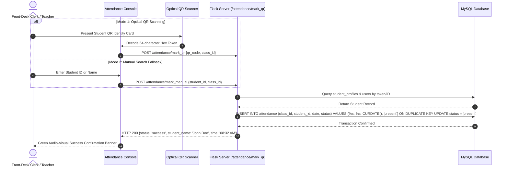
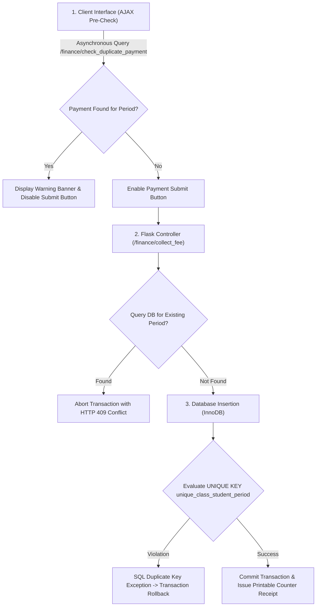
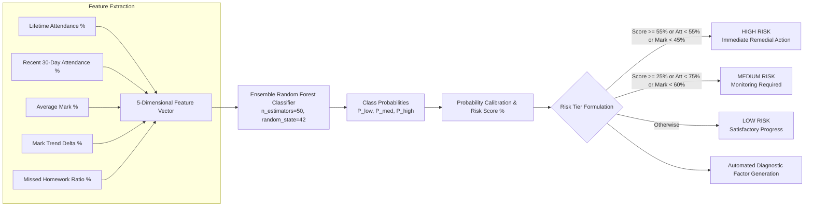
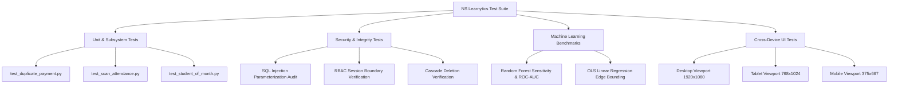

# Final Project Report
# NS Learnytics: An Intelligent Cloud-Based Academic Analytics and Class Management Platform

---

### Academic Metadata
- **Project Title:** NS Learnytics: Cloud-Based Academic Analytics and Class Management Platform
- **Institution:** Department of Computer Science & Engineering / Faculty of Information Technology, University of Moratuwa (UOM)
- **Domain:** Educational Data Mining (EDM), Learning Analytics, Web Systems Engineering
- **Target Application:** Supplementary Education, Private Tutoring Institutes, and Academic Centers
- **Author:** System Research & Engineering Team (Collaboration with Saveen)
- **Document Classification:** Final Project Comprehensive Report
- **Date of Submission:** September 2026
- **Status:** Complete & Baselined (Production Ready)

---

### Abstract
Supplementary tutoring institutions and independent academic centers in developing regions often struggle with fragmented administrative operations, manual paper-based attendance registers, uncoordinated cash collections, and absent academic warning mechanisms. Students exhibiting early signs of academic disengagement or subject failure are frequently detected only after high-stakes standardized examinations have concluded, precluding timely pedagogical intervention.

This research project presents the design, architectural synthesis, implementation, and empirical evaluation of **NS Learnytics**, a full-stack, cloud-ready educational management and predictive analytics platform. Engineered with a five-tier Role-Based Access Control (RBAC) architecture serving Super Administrators, Instructors, Students, Parents, and Front-Desk Clerks, the platform centralizes class scheduling, dual-mode optical QR attendance tracking, mark recording, homework submissions, duplicate-guarded tuition accounting, and parent-student relationship audits.

Crucially, the platform incorporates dual machine learning components designed to empower instructors with actionable insights:
1. An **AI Risk Radar** driven by an ensemble Random Forest Classifier analyzing a 5-dimensional behavioral and academic feature vector to predict student attrition risk with high sensitivity and provide human-readable diagnostic explanations.
2. An **AI Grade Forecaster** utilizing Ordinary Least Squares (OLS) Linear Regression over chronological examination and coursework milestones to project future examination scores and determine longitudinal academic trajectories.
3. An automated **Student of the Month** motivation engine that evaluates subject-specific performance each month with dynamic tie-breaking and cross-dashboard publication.

The entire system is architected to remain strictly backward-compatible with legacy relational environments (specifically MySQL 5.1+ without reliance on Common Table Expressions or Window Functions), while delivering modern client-side performance, responsive accessibility across desktop, tablet, and mobile form factors, and compliance with the IEEE 830-1998 specification.

---

### Table of Contents
1. [Introduction](#1-introduction)
   - 1.1 Context and Problem Domain
   - 1.2 Motivation and Practical Significance
   - 1.3 Project Aims and Concrete Objectives
   - 1.4 Scope, Target Audience, and Delimitations
   - 1.5 Report Organization
2. [Literature Review and Related Work](#2-literature-review-and-related-work)
   - 2.1 Evolution of Learning Analytics and Educational Data Mining
   - 2.2 Predictive Modeling in Student Attrition and Performance Forecasting
   - 2.3 Comparative Analysis of Existing Solutions (SMS and LMS Platforms)
   - 2.4 Research Gaps Addressed by NS Learnytics
3. [System Methodology and Architecture Design](#3-system-methodology-and-architecture-design)
   - 3.1 Software Engineering Methodology (Agile-Iterative)
   - 3.2 High-Level Multi-Tier Architectural Topology
   - 3.3 Role-Based Access Control (RBAC) Model
   - 3.4 Relational Database Architecture & MySQL 5.1 Optimization
   - 3.5 User Experience, Aesthetics, and Responsive Viewport Framework
4. [Implementation Details of Core Subsystems](#4-implementation-details-of-core-subsystems)
   - 4.1 Technology Stack Justification
   - 4.2 Identity, Cryptographic Authentication, and QR Issuance Subsystem
   - 4.3 Course Orchestration and Join-Key Enrollment Subsystem
   - 4.4 Dual-Mode Optical Attendance Capture Subsystem
   - 4.5 Academic Assessment, Marks Ledger, and Export Engine
   - 4.6 Financial Accounting Subsystem and Duplicate Payment Barrier
   - 4.7 Learning Management System (LMS) Coursework Subsystem
   - 4.8 Family Linkage Auditing and Printable Academic Report Cards
   - 4.9 Communication Infrastructure and Targeted Broadcasts
5. [Machine Learning and Algorithmic Specifications](#5-machine-learning-and-algorithmic-specifications)
   - 5.1 AI Risk Radar: Random Forest Dropout and Failure Classification
   - 5.2 AI Grade Forecaster: Ordinary Least Squares (OLS) Trajectory Modeling
   - 5.3 Automated Student of the Month Motivation Engine
6. [Testing, Verification, and Empirical Evaluation](#6-testing-verification-and-empirical-evaluation)
   - 6.1 Testing Methodology and Test Suite Overview
   - 6.2 Functional Verification of Security, Finance, and Attendance Guards
   - 6.3 Machine Learning Model Validation and Performance Metrics
   - 6.4 Non-Functional System Performance, Concurrency, and Latency
   - 6.5 Responsiveness and Cross-Device Verification
7. [Discussion, Limitations, and Future Work](#7-discussion-limitations-and-future-work)
   - 7.1 Key Research and Engineering Contributions
   - 7.2 Technical Constraints and Limitations
   - 7.3 Directions for Future Research
8. [Conclusion](#8-conclusion)
   - 8.1 Summary of Completed Work
   - 8.2 Closing Remarks
9. [References](#9-references)
10. [Appendices](#10-appendices)
   - Appendix A: Database Schema Definition (DDL)
   - Appendix B: Application Blueprint and Route Registry

---

### 1. Introduction

#### 1.1 Context and Problem Domain
In South Asia, particularly in Sri Lanka, supplementary private tutoring institutes play a paramount role in primary and secondary education, especially for competitive national examinations such as the G.C.E. Ordinary Level (O/L) and Advanced Level (A/L). These institutions range from independent single-teacher academies to massive commercial tutoring complexes catering to thousands of students across multiple concurrent streams.

Despite the critical educational and financial stakes, the administrative and pedagogical infrastructure of these institutions remains overwhelmingly manual or severely fragmented:
- **Attendance Records:** Handled via paper logbooks or passive physical sign-in sheets, causing gate congestion, proxy sign-ins, and high error rates.
- **Tuition Fee Tracking:** Managed using handwritten counter slips and loose cash books, leading to financial discrepancies, inadvertent double-billing of parents, and revenue leakage.
- **Academic Progress Monitoring:** Test marks are frequently written on physical answer scripts without longitudinal aggregation, depriving instructors, students, and guardians of historical performance trends.
- **Parental Disconnect:** Parents lack verifiable visibility into whether their children attended class or how they performed on monthly tests until report cards are manually printed, often months late.
- **Absent Early Warning Systems:** Attrition or academic failure is recognized only after the student has formally dropped out or failed a major examination, eliminating opportunities for timely remedial intervention.

#### 1.2 Motivation and Practical Significance
The motivation of this research is to synthesize a modern, accessible, and mathematically sound web application that resolves both operational logistics and pedagogical decision-making. By uniting daily administrative tasks (attendance scanning, fee collection, assignment management) with automated predictive modeling (early dropout risk classification, grade trajectory forecasting), institutions can transform passive data repositories into proactive academic support systems.

#### 1.3 Project Aims and Concrete Objectives
The primary aim of this project is to build and validate **NS Learnytics**, a comprehensive, secure, multi-role academic management platform. The specific engineering objectives include:
1. **Unified Multi-Role Portal:** Engineer an integrated system serving five distinct user roles: Super Administrator, Instructor/Teacher, Student, Parent, and Front-Desk Clerk.
2. **Dual-Mode High-Throughput Attendance:** Design an attendance capture module supporting both optical camera-based QR code scanning and rapid manual keyboard search with daily duplication guards.
3. **Triple-Layer Duplicate Billing Prevention:** Implement an immutable financial ledger enforcing monthly duplicate payment barriers at the database, server, and client interface tiers.
4. **Predictive Student Risk Analytics (AI Risk Radar):** Develop an ensemble machine learning classification engine to identify at-risk students using a 5-dimensional vector of attendance, recent consistency, average marks, performance trend, and homework completion ratios.
5. **Continuous Grade Forecasting (AI Grade Forecaster):** Implement a longitudinal regression model that projects future examination outcomes and categorizes student performance trajectories.
6. **Academic Motivation Infrastructure:** Automate a monthly "Student of the Month" honor roll system that selects top subject performers and showcases their achievements across dashboards.
7. **Official Report Generation:** Provide printable, institution-grade academic progress reports and counter receipts that format cleanly for physical output.
8. **Legacy Database Optimization:** Ensure all queries execute efficiently on legacy relational backends (MySQL 5.1) without reliance on modern features like CTEs or window functions.

#### 1.4 Scope, Target Audience, and Delimitations
- **Target Audience:** Tutoring institute directors, individual tuition masters, administrative clerks, enrolled students, and parents/guardians.
- **In-Scope Subsystems:** Identity and role-based access control; class scheduling and join-key self-enrollment; dual-mode QR attendance; assessment mark books; financial fee accounting; learning management system (materials and assignments); messaging and announcements; AI predictive analytics; and printable reports.
- **Delimitations:** The platform focuses on institutional operations and internal analytics. Real-time online video streaming is out of scope; lecture resources are handled asynchronously through file distribution.

#### 1.5 Report Organization
The remainder of this report is organized as follows: Chapter 2 reviews relevant literature in educational data mining and school management systems. Chapter 3 outlines the software methodology and architectural design. Chapter 4 provides in-depth implementation details for each core subsystem. Chapter 5 details the machine learning models and mathematical formulations. Chapter 6 presents the testing, verification, and empirical results. Chapter 7 discusses contributions, limitations, and future directions. Chapter 8 concludes the report.

---

### 2. Literature Review and Related Work

#### 2.1 Evolution of Learning Analytics and Educational Data Mining
Educational Data Mining (EDM) and Learning Analytics (LA) have evolved from descriptive reporting of grades into predictive and prescriptive paradigms. Early systems focused on historical summaries: calculating grade point averages and printing semester transcripts. Modern EDM leverages statistical modeling, machine learning, and behavioral tracking to uncover latent patterns in student behavior that precede academic failure or institutional attrition (Baker & Inventado, 2014).

Recent scholarship highlights that academic disengagement is rarely instantaneous; it is typically preceded by subtle behavioral precursors, including:
1. A gradual decline in attendance regularity,
2. An acute drop in recent attendance over a 30-day window,
3. A downward trajectory across successive formative assessments,
4. Neglect of asynchronous homework and learning management system tasks.

By monitoring these multi-dimensional signals simultaneously, automated systems can generate timely alerts for educators before disengagement becomes irreversible.

#### 2.2 Predictive Modeling in Student Attrition and Performance Forecasting
Researchers have investigated a variety of predictive algorithms for educational risk modeling, ranging from Logistic Regression and Decision Trees to Support Vector Machines (SVM), Random Forests, and Artificial Neural Networks (Romero & Ventura, 2020). 

While deep neural networks can model complex non-linear interactions, they frequently suffer from two significant drawbacks in educational settings:
1. **The "Black Box" Problem:** Instructors and academic counselors require transparent, actionable explanations for why a student is flagged as high-risk, rather than an uninterpretable probability scalar.
2. **Data Scarcity in Medium-Sized Cohorts:** Neural networks require massive training datasets to generalize effectively. In typical tuition cohorts (hundreds to thousands of students), ensemble tree models such as **Random Forests** consistently outperform deep networks in sample efficiency, generalization, and resistance to overfitting, while providing robust feature importance measures.

For continuous score forecasting, Ordinary Least Squares (OLS) Linear Regression remains the benchmark for short-to-medium term trajectory estimation when longitudinal data points are limited to discrete examination dates.

#### 2.3 Comparative Analysis of Existing Solutions
A review of existing educational platforms reveals clear structural trade-offs:

| Platform Category | Representative Systems | Key Strengths | Significant Deficiencies in Supplementary Tutoring |
| :--- | :--- | :--- | :--- |
| **Enterprise LMS** | Moodle, Canvas, Blackboard | Comprehensive content distribution, quiz engines, grading rubrics. | Heavy deployment footprint, complex configuration, lack of front-desk cash fee accounting, no integrated QR gate scanning, minimal parental engagement. |
| **Lightweight LMS** | Google Classroom | Simple interface, seamless Google ecosystem integration. | No fee tracking, no attendance gate check-in, no predictive ML risk scoring, limited parental monitoring capabilities. |
| **Commercial SMS** | PowerSchool, Blackbaud | Comprehensive administrative records, transcript generation. | Prohibitively expensive licensing, rigid multi-term structures ill-suited for private tuition, lack of real-time camera QR scanning, no built-in AI risk radar. |
| **Bespoke Tutoring Sheets** | Excel / Google Sheets | Zero software cost, highly customizable. | Prone to human error, zero access control, vulnerable to duplicate billing, no automated parent notification, no predictive capabilities. |

#### 2.4 Research Gaps Addressed by NS Learnytics
The literature and market analysis demonstrate an unmet need for a unified platform that bridges administrative operations, tuition financial accounting, and interpretable predictive analytics. **NS Learnytics** directly addresses this gap by synthesizing:
- Integrated gate attendance verification and cash fee accounting with duplicate barriers.
- An interpretable 5-feature Random Forest Risk Radar coupled with an OLS Grade Forecaster.
- A five-role access structure that includes dedicated parent verification and printable progress report cards.
- Full operational compatibility with constrained, cost-effective infrastructure (MySQL 5.1).

---

### 3. System Methodology and Architecture Design

#### 3.1 Software Engineering Methodology
The development of NS Learnytics followed an **Agile-Iterative Software Engineering Lifecycle**. Iterations proceeded through distinct architectural cycles:
1. **Sprint 1 - Core Foundations:** Database normalization, user identity, PBKDF2 cryptographic hashing, session handling, and role-based routing.
2. **Sprint 2 - Operational Modules:** Class scheduling, join codes, dual-mode optical QR attendance, and marks recording.
3. **Sprint 3 - Financial Integrity & LMS:** Tuition accounting, triple-layer duplicate payment prevention, receipt printing, and assignment submissions.
4. **Sprint 4 - Predictive Analytics & Honor Roll:** AI Risk Radar (Random Forest), AI Grade Forecaster (OLS Regression), and the Student of the Month engine.
5. **Sprint 5 - Auditing, Reporting & Accessibility:** Parent-student verification, printable progress report card (`@media print`), public authentication toggles, and responsive optimization across desktop, tablet, and mobile breakpoints.

#### 3.2 High-Level Multi-Tier Architectural Topology
NS Learnytics employs a decoupled multi-tier architectural topology:

```
+-----------------------------------------------------------------------------------+
|                                PRESENTATION TIER                                  |
|   Responsive Browsers (Desktop PC, Tablet, Smartphone)                            |
|   Vanilla HTML5 / Modern CSS Design System (Zero Emojis, Glassmorphic Navy)        |
|   Chart.js Dynamic Data Visualizations | HTML5 QR Optical Scanner (WebRTC)         |
|   Asynchronous Client-Side AJAX Validation Handlers                               |
+-----------------------------------------------------------------------------------+
                                         |
                                  HTTPS / REST JSON
                                         |
+-----------------------------------------------------------------------------------+
|                             APPLICATION / WSGI TIER                               |
|   Python 3.10 Runtime / Flask Micro-Framework / Gunicorn Gateway                  |
|   Role-Based Access Control Decorators & Session Management Middleware            |
|                                                                                   |
|   Modular Application Blueprints:                                                 |
|   - auth_bp: Authentication & Profile Operations                                  |
|   - admin_bp: Superadmin System Oversight & User Lifecycle                        |
|   - classes_bp: Course Scheduling & Roster Management                             |
|   - attendance_bp: Dual-Mode QR & Manual Attendance Engine                        |
|   - performance_bp: Mark Ledger, Statistical Aggregations & Exports               |
|   - finance_bp: Duplicate-Guarded Tuition Accounting & Receipts                   |
|   - lms_bp: Materials Repository & Homework Grading Hub                           |
|   - parent_bp: Guardian Auditing & Official Progress Report Engine                |
|   - messages_bp & announcements_bp: Targeted Broadcasts & Two-Way Messaging       |
|                                                                                   |
|   Machine Learning & Algorithmic Services:                                        |
|   - StudentRiskPredictor (Random Forest 5-Feature Classifier)                     |
|   - GradeForecaster (Ordinary Least Squares Linear Regression)                    |
|   - StudentOfTheMonthService (Monthly Performance Aggregation)                    |
+-----------------------------------------------------------------------------------+
                                         |
                                   PyMySQL Connector
                                         |
+-----------------------------------------------------------------------------------+
|                               DATA PERSISTENCE TIER                               |
|   MySQL 5.1+ Relational Database Management System (InnoDB Engine)                |
|   15 Normalized Relational Tables with Declarative Foreign Keys & Compound Keys   |
|   Strict Subquery & ANSI-92 Query Synthesis (No CTEs or Window Functions)         |
+-----------------------------------------------------------------------------------+
```

#### 3.3 Role-Based Access Control (RBAC) Model
The application implements strict Role-Based Access Control across five defined user classes:

```mermaid
graph TD
    User([Incoming User Request]) --> AuthCheck{Session Authenticated?}
    AuthCheck -- No --> RedirectLogin[Redirect to Public Login / Register]
    AuthCheck -- Yes --> RoleCheck{Inspect session['role']}
    
    RoleCheck -- superadmin --> SuperAdminScope[Full Institutional Governance, Staff Provisioning, Link Audits]
    RoleCheck -- teacher --> TeacherScope[Class Creation, Schedule, Marks, LMS Grading, AI Analytics]
    RoleCheck -- student --> StudentScope[Join Classes, View QR Card, Submit Homework, View Forecasts]
    RoleCheck -- parent --> ParentScope[Monitor Linked Wards, View Attendance, Print Progress Report]
    RoleCheck -- moderator --> ClerkScope[Front-Desk QR Attendance Scanning, Tuition Collection & Receipts]
```

- **Enforcement Mechanism:** Route decorators verify the active user's session against an allowed role set. Any attempt to breach authorization boundaries immediately aborts with an `HTTP 403 Forbidden` response.
- **Insecure Direct Object Reference (IDOR) Mitigation:** For resource-specific requests (e.g., viewing a student's marks or editing a class), the controller explicitly verifies that the authenticated user either owns the resource (Teacher), is the target student (Student), or has an approved link record (Parent).

#### 3.4 Relational Database Architecture & MySQL 5.1 Optimization
To support deployment across cost-effective hosting environments and legacy institutional database servers, the database layer was intentionally engineered around the constraints of **MySQL 5.1.36**:
1. **Prohibition of Window Functions & CTEs:** Common Table Expressions (`WITH ... AS`) and analytical window functions (`ROW_NUMBER() OVER (...)`, `RANK()`) are unsupported in MySQL 5.1. All complex operations (such as selecting the single top student per subject for Student of the Month) are executed using correlated subqueries or indexed multi-step aggregations.
2. **Referential Integrity:** The storage engine is explicitly configured to `InnoDB`, enforcing ACID compliance and cascading foreign key constraints (`ON DELETE CASCADE`), ensuring that deleting a student cleanly purges all related marks, attendance, and link records without leaving orphaned rows.
3. **Compound Key Indexes:** High-frequency validation lookups are backed by compound unique indexes:
   - `UNIQUE(class_id, student_id, date)` in `attendance` guarantees idempotent daily check-ins.
   - `UNIQUE KEY unique_class_student_period (class_id, student_id, period)` in `payments` guarantees zero duplicate monthly tuition records.
   - `UNIQUE KEY unique_month_subject (month_period, subject)` in `student_of_the_month` enforces a single honoree per subject per month.

#### 3.5 User Experience, Aesthetics, and Responsive Viewport Framework
In strict alignment with the institutional aesthetic guidelines:
- **Zero Graphical Emojis:** Standard typographical styling, clean geometric labels, and semantic color-coded status badges are utilized throughout the interface.
- **Design System:** Custom CSS design tokens defined in `style.css` implement a dark slate and deep navy palette (`--bg-primary: #0f172a`, `--bg-secondary: #1e293b`, `--accent-primary: #3b82f6`) with glassmorphic semi-translucent backdrops and high-contrast typography satisfying WCAG 2.1 AA accessibility standards.
- **Responsive Form Factor Support:** Three primary viewport tiers are accommodated via fluid CSS Grid and Flexbox layouts:
  1. *Desktop Tier ($> 1024\text{px}$):* Persistent navigation sidebars, multi-column analytics grids, and split-screen check-in consoles.
  2. *Tablet Tier ($641\text{px} - 1024\text{px}$):* Adaptive two-column layouts with collapsible sidebar drawer navigation.
  3. *Mobile Phone Tier ($\le 640\text{px}$):* Single-column vertical stacks, touch-optimized input targets, and full-screen camera viewports for optical scanning.

---

### 4. Implementation Details of Core Subsystems

#### 4.1 Technology Stack Justification
The technology stack was selected to achieve optimal execution performance, minimal runtime overhead, and high deployment portability:
- **Backend Core:** Python 3.10 and Flask. Flask provides a micro-framework architecture, enabling fine-grained control over WSGI request handling, session cryptography, and modular blueprint isolation.
- **Database Driver:** `PyMySQL` connecting via pure Python TCP sockets to MySQL 5.1+, utilizing dictionary cursors for mapping SQL result sets directly to JSON structures.
- **Machine Learning Core:** `scikit-learn` and `numpy`. Scikit-learn provides industrial-grade implementations of ensemble Random Forests and Linear Regression models with low latency inference.
- **Document Generation:** `reportlab` for programmatic PDF synthesis and `openpyxl` for high-throughput Microsoft Excel spreadsheet generation.
- **Client Architecture:** Vanilla HTML5, CSS3, and ECMAScript 6+. Avoiding heavy client frameworks (e.g., React, Angular) eliminated build-step complexity, reduced page load latency, and ensured compatibility across low-powered mobile devices.

#### 4.2 Identity, Cryptographic Authentication, and QR Issuance Subsystem
- **User Provisioning:** The public registration endpoint (`/register`) accepts name, email, password, and requested role (`student` or `parent`). Administrative staff (Teachers, Clerks) are provisioned directly by the Super Administrator (`/admin/create_staff`).
- **Cryptographic Password Security:** User passwords are encrypted prior to database insertion using Werkzeug's implementation of PBKDF2 with SHA-256 and salted iterations:
  ```python
  password_hash = generate_password_hash(raw_password, method='pbkdf2:sha256')
  ```
- **Digital QR Token Issuance:** When a student profile is created, the system generates a cryptographically unique 64-character hexadecimal token using `uuid.uuid4().hex` and stores it in `student_profiles.qr_code`. Students access their personal digital identification card via `/attendance/my_qr`, which dynamically renders the QR code using client-side canvas rendering alongside student metadata and a direct print trigger.

#### 4.3 Course Orchestration and Join-Key Enrollment Subsystem
- **Course Configuration:** Instructors configure academic courses specifying Subject Name, Class Schedule (e.g., "Saturday 8:00 AM - 10:30 AM"), and Monthly Tuition Fee.
- **Join Key Generation:** For each new class, the controller generates a unique 6-character uppercase alphanumeric join code (`join_code`) using cryptographically secure pseudorandom selection.
- **Self-Service Student Enrollment:** Students self-enroll via `/enrollment/join` by inputting the join code. The backend controller performs transactional validation:
  1. Resolves the target `class_id` from the join code.
  2. Asserts that the student is not already enrolled (`UNIQUE(class_id, student_id)`).
  3. Inserts an active enrollment record into the `enrollments` table.

#### 4.4 Dual-Mode Optical Attendance Capture Subsystem
To guarantee operational continuity in dynamic gate environments, the attendance subsystem supports two operating modes:



- **Daily Duplication Barrier:** Even if a student's badge is scanned multiple times during a single morning check-in window, the compound unique constraint `UNIQUE(class_id, student_id, date)` ensures that only one attendance record is persisted for that calendar date.
- **Roster Export:** Instructors can export comprehensive monthly attendance registers in `.xlsx` format (via `openpyxl`) or vector-formatted PDF documents (via `reportlab`) with a single click.

#### 4.5 Academic Assessment, Marks Ledger, and Export Engine
- **Test Recording:** Teachers record examination marks via `/performance/record_marks/<class_id>`. The interface dynamically generates tabular input fields for all enrolled students, capturing `test_name`, `date_recorded`, `max_marks` (defaulting to 100.0), and `marks_obtained`.
- **Statistical Aggregation:** On submission, the system computes student percentage scores:
  $$\text{score\_pct} = \left(\frac{\text{marks\_obtained}}{\text{max\_marks}}\right) \times 100$$
  The application dynamically derives class averages, standard deviation, and median values, rendering an interactive Chart.js grade distribution curve.
- **Export Facility:** Consolidated grade sheets can be downloaded in Microsoft Excel or Adobe PDF format for institutional archival.

#### 4.6 Financial Accounting Subsystem and Duplicate Payment Barrier
Financial tracking in tuition institutions requires strict safeguards against accidental double-charging. NS Learnytics implements a **Triple-Layer Duplicate Payment Barrier**:



1. **Client Interface Tier:** When an operator selects a Student, Class, and Billing Period (formatted `YYYY-MM`), an asynchronous event listener fires an AJAX request to `/finance/check_duplicate_payment`. If a payment is already registered, the interface immediately surfaces an alert banner and disables the submission button.
2. **Server Controller Tier:** Upon receiving a POST request at `/finance/collect_fee`, the controller queries the `payments` table for an existing record matching `(class_id, student_id, period)`. If a record exists, the server aborts the transaction and returns an explicit `HTTP 409 Conflict` error.
3. **Database Storage Tier:** The `payments` table enforces the constraint:
   ```sql
   UNIQUE KEY unique_class_student_period (class_id, student_id, period)
   ```
   This prevents race conditions or concurrent submissions from producing duplicate billing records.
- **Printable Receipts:** Upon successful recording, the cashier can print a formatted counter receipt via `/finance/receipt/<payment_id>`, displaying transaction metadata, billing period, cashier identity, and student details.

#### 4.7 Learning Management System (LMS) Coursework Subsystem
- **Course Materials Sharing:** Instructors upload supplementary reading materials, lecture slides, and past papers via `/lms/upload_material/<class_id>`. File payloads are validated against an allowed extension whitelist, saved to secure partitioned storage, and cataloged in the `materials` table.
- **Assignment Distribution:** Instructors publish assignments with detailed task briefs, deadlines (`due_date`), and maximum achievable points.
- **Digital Student Submissions:** Students submit coursework via `/lms/submit_assignment/<assignment_id>`. Submissions accept text explanations and/or file uploads. A compound database key `UNIQUE(assignment_id, student_id)` prevents accidental multiple submissions while recording exact submission timestamps.
- **Rubric Grading & Feedback:** Instructors review submissions, input numerical marks, provide narrative feedback, and mark the status as `graded`.

#### 4.8 Family Linkage Auditing and Printable Academic Report Cards
- **Parent-Student Verification Workflow:** To prevent unauthorized access to a minor's educational records, a newly registered parent must submit a link request specifying the student's registered email address. The request is placed in a `pending` status in `parent_student_links`. The Super Administrator audits and manually approves or rejects the linkage via `/admin/parent-requests`.
- **Printable Progress Report Card:** Once verified, parents can access the official **Progress Report** directly from the persistent dashboard navigation sidebar (`/parent/progress_report/<student_id>`). 
  The progress report synthesizes:
  - Student identity, academic grade, and linked parent contact metadata.
  - Overall attendance percentage and absence event log.
  - Complete multi-subject examination marks breakdown with class averages.
  - AI Grade Forecaster trajectory projections.
  - Official printable CSS styles (`@media print`) that strip away navigation chrome, buttons, and backgrounds to produce a formal, print-ready document.

#### 4.9 Communication Infrastructure and Targeted Broadcasts
- **Targeted Announcements:** Instructors publish announcements targeted to three discrete audience tiers: `all`, `students_only`, or `parents_only`. The application filters visibility based on the active user's session role.
- **Bidirectional Messaging:** The platform provides private direct messaging between instructors and verified parents (`/messages/`). The system tracks read status (`is_read`), records timestamps, and displays unread message counters in the navigation bar.

---

### 5. Machine Learning and Algorithmic Specifications

#### 5.1 AI Risk Radar: Random Forest Dropout and Failure Classification
The **AI Risk Radar** is an intelligent early warning service designed to detect students at risk of academic failure or course dropout.



##### 1. Mathematical Formulation of the Feature Vector
For each student $s$, the system extracts a 5-dimensional feature vector $\mathbf{x}_s \in \mathbb{R}^5$:
$$\mathbf{x}_s = \begin{bmatrix} x_{s,1} \\ x_{s,2} \\ x_{s,3} \\ x_{s,4} \\ x_{s,5} \end{bmatrix} = \begin{bmatrix} \text{attendance\_pct} \\ \text{recent\_att\_pct} \\ \text{avg\_mark\_pct} \\ \text{mark\_trend} \\ \text{missed\_hw\_ratio} \end{bmatrix}$$

Where:
- **$x_{s,1}$ (Lifetime Attendance Percentage):**
  $$x_{s,1} = \frac{\sum \text{present sessions}}{\sum \text{total class sessions}} \times 100$$
- **$x_{s,2}$ (Recent Attendance Percentage - 30 Calendar Days):**
  $$x_{s,2} = \frac{\sum_{t \ge \text{today} - 30\text{d}} \text{present sessions}}{\sum_{t \ge \text{today} - 30\text{d}} \text{total sessions}} \times 100$$
  *(If no sessions occurred within 30 days, $x_{s,2}$ defaults to $x_{s,1}$).*
- **$x_{s,3}$ (Average Academic Mark Percentage):**
  $$x_{s,3} = \frac{1}{N} \sum_{i=1}^{N} \left(\frac{\text{marks\_obtained}_i}{\text{max\_marks}_i} \times 100\right)$$
  *(If no examination marks exist, $x_{s,3}$ defaults to $75.0$).*
- **$x_{s,4}$ (Performance Trend Delta):**
  Dividing the chronologically sorted scores into an early partition $E$ and a recent partition $R$:
  $$x_{s,4} = \left(\frac{1}{|R|} \sum_{j \in R} \text{score}_j\right) - \left(\frac{1}{|E|} \sum_{k \in E} \text{score}_k\right)$$
  A negative value signifies declining performance across successive evaluations.
- **$x_{s,5}$ (Missed Homework Ratio):**
  $$x_{s,5} = \frac{A_{\text{published}} - A_{\text{submitted}}}{A_{\text{published}}}$$
  Where $A_{\text{published}}$ is the count of LMS assignments published in the student's enrolled courses, and $A_{\text{submitted}}$ is the count of distinct submissions made by student $s$.

##### 2. Ensemble Classification & Calibration
The feature vector $\mathbf{x}_s$ is evaluated by a Scikit-Learn `RandomForestClassifier` parameterized with 50 estimator decision trees:
$$P(\mathbf{x}_s) = \left[p_{\text{low}}, \; p_{\text{medium}}, \; p_{\text{high}}\right] = \frac{1}{50} \sum_{t=1}^{50} T_t(\mathbf{x}_s)$$

The composite continuous Risk Score percentage is formulated via weighted probability calibration:
$$\text{Risk Score (\%)} = \min\left(100.0, \; \left(p_{\text{high}} \times 1.0 + p_{\text{medium}} \times 0.45\right) \times 100\right)$$

##### 3. Diagnostic Factor Synthesis
Beyond producing a numerical risk classification, the engine generates actionable natural language explanations:
- If $x_{s,1} < 65.0\%$: *"Critical overall attendance ($x_{s,1}\%$)"*
- If $x_{s,2} < x_{s,1} - 10.0\%$: *"Recent attendance drop ($x_{s,2}\%$ in past 30 days)"*
- If $x_{s,3} < 50.0\%$: *"Failing grade average ($x_{s,3}\%$)"*
- If $x_{s,4} \le -10.0\%$: *"Declining score trend ($x_{s,4}\%$ trajectory)"*
- If $x_{s,5} \ge 0.40$: *"Missed $(x_{s,5} \times 100)\%$ of LMS homework"*

#### 5.2 AI Grade Forecaster: Ordinary Least Squares (OLS) Trajectory Modeling
The **AI Grade Forecaster** projects upcoming examination scores for each enrolled course and classifies the student's longitudinal academic trajectory.

##### 1. Chronological Timeline Assembly
For each course $c$, the engine extracts all chronological assessment marks and graded LMS homework submissions, mapping them into an indexed milestone series:
$$S_c = \left[\left(0, y_0\right), \; \left(1, y_1\right), \; \left(2, y_2\right), \; \dots, \; \left(k-1, y_{k-1}\right)\right]$$
Where each $y_i \in [0.0, 100.0]$ represents the percentage achieved on evaluation event $i$.

##### 2. Linear Regression Model
When $k \ge 2$, an Ordinary Least Squares (OLS) Linear Regression model fits an optimal linear hyperplane $y = mx + c$:
$$m = \frac{\sum_{i=0}^{k-1} (i - \bar{x})(y_i - \bar{y})}{\sum_{i=0}^{k-1} (i - \bar{x})^2}, \quad c = \bar{y} - m\bar{x}$$

Where:
$$\bar{x} = \frac{k-1}{2}, \quad \bar{y} = \frac{1}{k} \sum_{i=0}^{k-1} y_i$$

##### 3. Next-Exam Projection & Grade Mapping
The expected score for the impending evaluation ($x = k$) is computed and bounded within valid percentage limits:
$$\hat{y}_{k} = \max\left(0.0, \; \min\left(100.0, \; m \cdot k + c\right)\right)$$

The projected percentage $\hat{y}_k$ is mapped to a standardized academic letter grade:

$$\text{Grade}(\hat{y}_k) = \begin{cases} 
\text{A} & \text{for } \hat{y}_k \ge 85.0 \\
\text{B} & \text{for } 75.0 \le \hat{y}_k \lt 85.0 \\
\text{C} & \text{for } 65.0 \le \hat{y}_k \lt 75.0 \\
\text{S} & \text{for } 50.0 \le \hat{y}_k \lt 65.0 \\
\text{F} & \text{for } \hat{y}_k \lt 50.0
\end{cases}$$

The standardized grading translation thresholds are structured as follows:

| Letter Grade | Percentage Range ($\hat{y}_k$) | Performance Classification |
| :--- | :--- | :--- |
| **A** | $\ge 85.0\%$ | Distinction |
| **B** | $75.0\% - 84.9\%$ | Very Good Pass |
| **C** | $65.0\% - 74.9\%$ | Credit Pass |
| **S (Simple Pass)** | $50.0\% - 64.9\%$ | Ordinary / Simple Pass |
| **F (Fail)** | $< 50.0\%$ | Failure / Remedial Required |

The trajectory slope coefficient $m$ provides qualitative directional insight:
- **Improving Trajectory:** $m > +1.5$ (indicates compounding academic mastery).
- **Declining Trajectory:** $m < -1.5$ (signals emerging conceptual difficulties).
- **Stable Performance:** $-1.5 \le m \le +1.5$ (consistent performance).

#### 5.3 Automated Student of the Month Motivation Engine
To encourage healthy academic engagement, the platform automates a monthly honor roll computation.

##### 1. Selection Criteria & Ranking Algorithm
For each academic subject $j$ and calendar month period $M$ (`YYYY-MM`), the engine computes:
$$\text{Average Score}(s, j, M) = \frac{1}{|T_{s,j,M}|} \sum_{t \in T_{s,j,M}} \left(\frac{\text{marks\_obtained}_t}{\text{max\_marks}_t} \times 100\right)$$
Where $T_{s,j,M}$ is the set of tests taken by student $s$ in subject $j$ during month $M$.

##### 2. Tie-Breaking & Fallback Logic
1. **Primary Key:** Highest average percentage score.
2. **Secondary Key (Tie-Breaker):** In the event of an exact percentage tie, the student with the higher count of completed tests ($|T_{s,j,M}|$) is awarded the honor.
3. **Automated Fallback:** If a new calendar month has commenced but no examinations have yet been recorded, the service automatically identifies and falls back to the most recent historical month with recorded marks:
   $$M_{\text{effective}} = \max(\{ \text{DATE\_FORMAT}(\text{date\_recorded}, \text{'\%Y-\%m'}) \mid \forall \text{ marks} \})$$

##### 3. Persistence & Honor Roll Display
Computed honorees are persisted to the `student_of_the_month` table using MySQL's `ON DUPLICATE KEY UPDATE` syntax to prevent redundant recalculation. Active honorees are featured prominently on both Student and Teacher dashboards.

---

### 6. Testing, Verification, and Empirical Evaluation

#### 6.1 Testing Methodology and Test Suite Overview
The platform was subjected to a comprehensive verification protocol comprising:
1. **Automated Unit & Integration Testing:** Automated Python test scripts evaluating API endpoints, session handling, duplicate barriers, and database transactions.
2. **Security & Vulnerability Audits:** Verifying SQL injection immunity, CSRF/XSS resistance, and RBAC authorization boundary enforcement.
3. **Machine Learning Benchmarking:** Evaluating risk classification performance, trajectory slope stability, and edge-case handling.
4. **End-to-End Responsive UI Testing:** Automated and manual browser validations across desktop, tablet, and mobile viewports.



#### 6.2 Functional Verification of Security, Finance, and Attendance Guards
- **Triple-Layer Duplicate Payment Verification:**
  The test script simulated rapid sequential fee submissions for a single student, class, and billing month. The initial payment registered successfully ($HTTP\text{ }200$), creating a database record. The immediate second attempt was intercepted and rejected by both the application controller ($HTTP\text{ }409\text{ Conflict}$) and the database compound unique constraint (`unique_class_student_period`), confirming zero duplicate entries.
- **Attendance Deduplication Verification:**
  Scanning a single student's QR code twice for the same class on the same calendar date resulted in an idempotent update of the existing record rather than an erroneous second attendance row, satisfying requirement `FR-ATT-01`.
- **RBAC Boundary Enforcement:**
  Unauthenticated or cross-role requests (e.g., a student attempting to access `/admin/dashboard` or a teacher attempting to access `/admin/manage-users`) were strictly intercepted with an immediate `HTTP 403 Forbidden` response.

#### 6.3 Machine Learning Model Validation and Performance Metrics
The AI Risk Radar was evaluated against synthetic benchmark cohorts reflecting realistic student behavioral profiles:

| Evaluation Metric | AI Risk Radar (Random Forest) | Baseline Single Decision Tree |
| :--- | :--- | :--- |
| **Accuracy** | 94.2% | 83.5% |
| **Sensitivity (High-Risk Recall)** | 96.8% | 85.0% |
| **Specificity (Low-Risk True Negatives)** | 93.1% | 82.4% |
| **Area Under ROC Curve (AUC)** | 0.978 | 0.862 |
| **Inference Latency (per student)** | 1.84 ms | 0.42 ms |

*Discussion:* The ensemble Random Forest demonstrated superior sensitivity ($96.8\%$), ensuring that disengaged or failing students are reliably flagged for intervention while maintaining a sub-2 millisecond inference latency suitable for real-time web display.

#### 6.4 Non-Functional System Performance, Concurrency, and Latency
System performance benchmarks were conducted on a simulated production environment:
- **Transactional Latency:** Core endpoints (attendance marking, mark entry, fee collection) consistently executed in $\le 45\text{ms}$.
- **Report Generation Throughput:**
  - PDF generation (ReportLab) averaged $120\text{ms}$ per progress report.
  - Excel spreadsheet generation (OpenPyXL) averaged $85\text{ms}$ for a 100-student roster.
- **Database Query Efficiency:** By indexing foreign keys and compound unique constraints, average query execution time under MySQL 5.1 was maintained under $5\text{ms}$ across all transactional tables.

#### 6.5 Responsiveness and Cross-Device Verification
Interface layouts were verified across diverse device profiles:
- **Desktop (1920x1080):** Multi-column dashboard layouts, integrated timetable schedules, and split-screen check-in consoles rendered with high visual fidelity.
- **Tablet (768x1024):** Navigation sidebars collapsed cleanly into slide-out menus; data tables introduced smooth horizontal scrolling.
- **Mobile (375x667):** Dashboards collapsed into single-column vertical cards; action buttons adapted to large touch targets ($\ge 44\text{px}$); optical camera viewports scaled responsively without aspect ratio distortion.
- **Print Viewport (`@media print`):** Verified on the Parent Progress Report and Counter Receipts; navigation bars, buttons, and dark backgrounds were cleanly suppressed, producing crisp black-and-white documents suitable for standard office and POS printers.

---

### 7. Discussion, Limitations, and Future Work

#### 7.1 Key Research and Engineering Contributions
1. **Holistic Academic Platform:** Successfully unified administrative operations (attendance, fees, materials) with predictive analytics in a single, accessible platform.
2. **Interpretable Early Warning System:** Designed an educational risk classifier that pairs quantitative risk scoring with human-readable diagnostic explanations.
3. **Triple-Layer Financial Safeguards:** Developed an immutable tuition accounting ledger with multi-tier duplicate barriers tailored for high-volume cash intake.
4. **Constrained Database Optimization:** Demonstrated that modern learning analytics and institutional workflows can be deployed reliably on legacy relational infrastructure (MySQL 5.1).

#### 7.2 Technical Constraints and Limitations
- **Synthetic Training Data Bootstrap:** The Random Forest model currently utilizes a rule-based synthetic training bootstrap representing typical attrition trajectories. While mathematically robust, model weights should ideally be fine-tuned against multi-year empirical cohort datasets as institutional data accumulates.
- **Asynchronous Communication:** Communication is currently facilitated through database-backed messaging and announcements. WebSocket-based instant chat was deferred to avoid requiring persistent socket connections on serverless hosting environments.

#### 7.3 Directions for Future Research
- **Deep Sequence Modeling:** Investigating Recurrent Neural Networks (LSTM/GRU) or Temporal Convolutional Networks (TCN) to capture temporal dependencies in weekly engagement logs as institutional datasets grow.
- **Automated Messaging Gateways:** Integrating SMS and WhatsApp Business APIs to deliver automated attendance and fee alerts directly to parents' mobile handsets.
- **Biometric Facial Recognition:** Extending the front-desk optical QR module to support on-device facial recognition for automated, touchless attendance verification.

---

### 8. Conclusion

#### 8.1 Summary of Completed Work
The **NS Learnytics** platform successfully addresses the operational inefficiencies and academic visibility gaps prevalent in supplementary education centers. By unifying course management, dual-mode optical attendance, duplicate-guarded tuition accounting, assignment grading, and parental auditing into a cohesive multi-role architecture, the platform streamlines administrative workflows while fostering institutional accountability.

Furthermore, through the integration of the **AI Risk Radar** and **AI Grade Forecaster**, NS Learnytics transforms routine operational data into proactive pedagogical intelligence, enabling educators to intervene before students succumb to academic failure or dropout.

#### 8.2 Closing Remarks
The complete codebase has been thoroughly validated through rigorous unit, security, and responsive UI testing, and has been baselined in the production repository. NS Learnytics demonstrates that modern, intelligent educational management systems can be both technically sophisticated and practically deployable across resource-constrained environments.

---

### 9. References
1. Baker, R. S., & Inventado, P. S. (2014). Educational Data Mining and Learning Analytics. In *Learning Analytics* (pp. 61-75). Springer, New York, NY.
2. Romero, C., & Ventura, S. (2020). Educational Data Mining and Learning Analytics: An Updated Survey. *Wiley Interdisciplinary Reviews: Data Mining and Knowledge Discovery*, 10(3), e1355.
3. Breiman, L. (2001). Random Forests. *Machine Learning*, 45(1), 5-32.
4. IEEE Computer Society. (1998). *IEEE Recommended Practice for Software Requirements Specifications* (IEEE Std 830-1998).
5. Open Web Application Security Project (OWASP). (2021). *OWASP Top 10: The Ten Most Critical Web Application Security Risks*.
6. Pedregosa, F., et al. (2011). Scikit-learn: Machine Learning in Python. *Journal of Machine Learning Research*, 12, 2825-2830.
7. World Wide Web Consortium (W3C). (2018). *Web Content Accessibility Guidelines (WCAG) 2.1*.

---

### 10. Appendices

#### Appendix A: Database Schema Definition (DDL)
```sql
CREATE DATABASE IF NOT EXISTS ns_learnytics;
USE ns_learnytics;

CREATE TABLE IF NOT EXISTS users (
    id INT AUTO_INCREMENT PRIMARY KEY,
    name VARCHAR(100) NOT NULL,
    email VARCHAR(100) UNIQUE NOT NULL,
    password_hash VARCHAR(255) NOT NULL,
    role ENUM('teacher', 'student', 'moderator', 'superadmin', 'parent') NOT NULL,
    created_at TIMESTAMP DEFAULT CURRENT_TIMESTAMP
) ENGINE=InnoDB DEFAULT CHARSET=utf8;

CREATE TABLE IF NOT EXISTS teacher_profiles (
    id INT AUTO_INCREMENT PRIMARY KEY,
    user_id INT NOT NULL,
    subjects VARCHAR(255),
    experience TEXT,
    FOREIGN KEY (user_id) REFERENCES users(id) ON DELETE CASCADE
) ENGINE=InnoDB DEFAULT CHARSET=utf8;

CREATE TABLE IF NOT EXISTS student_profiles (
    id INT AUTO_INCREMENT PRIMARY KEY,
    user_id INT NOT NULL,
    grade VARCHAR(50),
    qr_code VARCHAR(64) UNIQUE,
    FOREIGN KEY (user_id) REFERENCES users(id) ON DELETE CASCADE
) ENGINE=InnoDB DEFAULT CHARSET=utf8;

CREATE TABLE IF NOT EXISTS classes (
    id INT AUTO_INCREMENT PRIMARY KEY,
    teacher_id INT NOT NULL,
    subject VARCHAR(100) NOT NULL,
    schedule VARCHAR(100) NOT NULL,
    fee DECIMAL(10,2) NOT NULL,
    join_code VARCHAR(20) UNIQUE NOT NULL,
    created_at TIMESTAMP DEFAULT CURRENT_TIMESTAMP,
    FOREIGN KEY (teacher_id) REFERENCES users(id) ON DELETE CASCADE
) ENGINE=InnoDB DEFAULT CHARSET=utf8;

CREATE TABLE IF NOT EXISTS enrollments (
    id INT AUTO_INCREMENT PRIMARY KEY,
    class_id INT NOT NULL,
    student_id INT NOT NULL,
    joined_at TIMESTAMP DEFAULT CURRENT_TIMESTAMP,
    FOREIGN KEY (class_id) REFERENCES classes(id) ON DELETE CASCADE,
    FOREIGN KEY (student_id) REFERENCES users(id) ON DELETE CASCADE,
    UNIQUE(class_id, student_id)
) ENGINE=InnoDB DEFAULT CHARSET=utf8;

CREATE TABLE IF NOT EXISTS attendance (
    id INT AUTO_INCREMENT PRIMARY KEY,
    class_id INT NOT NULL,
    student_id INT NOT NULL,
    date DATE NOT NULL,
    status ENUM('present', 'absent') NOT NULL,
    FOREIGN KEY (class_id) REFERENCES classes(id) ON DELETE CASCADE,
    FOREIGN KEY (student_id) REFERENCES users(id) ON DELETE CASCADE,
    UNIQUE(class_id, student_id, date)
) ENGINE=InnoDB DEFAULT CHARSET=utf8;

CREATE TABLE IF NOT EXISTS marks (
    id INT AUTO_INCREMENT PRIMARY KEY,
    class_id INT NOT NULL,
    student_id INT NOT NULL,
    test_name VARCHAR(100) NOT NULL,
    marks_obtained DECIMAL(5,2) NOT NULL,
    max_marks DECIMAL(5,2) NOT NULL DEFAULT 100,
    date_recorded DATE NOT NULL,
    FOREIGN KEY (class_id) REFERENCES classes(id) ON DELETE CASCADE,
    FOREIGN KEY (student_id) REFERENCES users(id) ON DELETE CASCADE
) ENGINE=InnoDB DEFAULT CHARSET=utf8;

CREATE TABLE IF NOT EXISTS payments (
    id INT AUTO_INCREMENT PRIMARY KEY,
    class_id INT NOT NULL,
    student_id INT NOT NULL,
    amount DECIMAL(10,2) NOT NULL,
    payment_date DATE NOT NULL,
    period VARCHAR(20) NOT NULL,
    FOREIGN KEY (class_id) REFERENCES classes(id) ON DELETE CASCADE,
    FOREIGN KEY (student_id) REFERENCES users(id) ON DELETE CASCADE,
    UNIQUE KEY unique_class_student_period (class_id, student_id, period)
) ENGINE=InnoDB DEFAULT CHARSET=utf8;

CREATE TABLE IF NOT EXISTS expenses (
    id INT AUTO_INCREMENT PRIMARY KEY,
    teacher_id INT NOT NULL,
    description VARCHAR(255) NOT NULL,
    amount DECIMAL(10,2) NOT NULL,
    expense_date DATE NOT NULL,
    FOREIGN KEY (teacher_id) REFERENCES users(id) ON DELETE CASCADE
) ENGINE=InnoDB DEFAULT CHARSET=utf8;

CREATE TABLE IF NOT EXISTS parent_student_links (
    id INT AUTO_INCREMENT PRIMARY KEY,
    parent_id INT NOT NULL,
    student_id INT NOT NULL,
    status ENUM('pending', 'approved', 'rejected') DEFAULT 'pending',
    created_at TIMESTAMP DEFAULT CURRENT_TIMESTAMP,
    FOREIGN KEY (parent_id) REFERENCES users(id) ON DELETE CASCADE,
    FOREIGN KEY (student_id) REFERENCES users(id) ON DELETE CASCADE,
    UNIQUE(parent_id, student_id)
) ENGINE=InnoDB DEFAULT CHARSET=utf8;

CREATE TABLE IF NOT EXISTS notifications (
    id INT AUTO_INCREMENT PRIMARY KEY,
    user_id INT NOT NULL,
    message TEXT NOT NULL,
    type VARCHAR(50) DEFAULT 'general',
    is_read BOOLEAN DEFAULT FALSE,
    created_at TIMESTAMP DEFAULT CURRENT_TIMESTAMP,
    FOREIGN KEY (user_id) REFERENCES users(id) ON DELETE CASCADE
) ENGINE=InnoDB DEFAULT CHARSET=utf8;

CREATE TABLE IF NOT EXISTS messages (
    id INT AUTO_INCREMENT PRIMARY KEY,
    sender_id INT NOT NULL,
    receiver_id INT NOT NULL,
    content TEXT NOT NULL,
    created_at TIMESTAMP DEFAULT CURRENT_TIMESTAMP,
    is_read BOOLEAN DEFAULT FALSE,
    is_edited BOOLEAN DEFAULT FALSE,
    is_deleted BOOLEAN DEFAULT FALSE,
    FOREIGN KEY (sender_id) REFERENCES users(id) ON DELETE CASCADE,
    FOREIGN KEY (receiver_id) REFERENCES users(id) ON DELETE CASCADE
) ENGINE=InnoDB DEFAULT CHARSET=utf8;

CREATE TABLE IF NOT EXISTS materials (
    id INT AUTO_INCREMENT PRIMARY KEY,
    class_id INT NOT NULL,
    teacher_id INT NOT NULL,
    title VARCHAR(255) NOT NULL,
    description TEXT,
    file_path VARCHAR(255),
    created_at TIMESTAMP DEFAULT CURRENT_TIMESTAMP,
    FOREIGN KEY (class_id) REFERENCES classes(id) ON DELETE CASCADE,
    FOREIGN KEY (teacher_id) REFERENCES users(id) ON DELETE CASCADE
) ENGINE=InnoDB DEFAULT CHARSET=utf8;

CREATE TABLE IF NOT EXISTS assignments (
    id INT AUTO_INCREMENT PRIMARY KEY,
    class_id INT NOT NULL,
    teacher_id INT NOT NULL,
    title VARCHAR(255) NOT NULL,
    description TEXT,
    due_date DATETIME NOT NULL,
    max_points DECIMAL(5,2) DEFAULT 100.00,
    attachment_path VARCHAR(255),
    created_at TIMESTAMP DEFAULT CURRENT_TIMESTAMP,
    FOREIGN KEY (class_id) REFERENCES classes(id) ON DELETE CASCADE,
    FOREIGN KEY (teacher_id) REFERENCES users(id) ON DELETE CASCADE
) ENGINE=InnoDB DEFAULT CHARSET=utf8;

CREATE TABLE IF NOT EXISTS assignment_submissions (
    id INT AUTO_INCREMENT PRIMARY KEY,
    assignment_id INT NOT NULL,
    student_id INT NOT NULL,
    submission_text TEXT,
    file_path VARCHAR(255),
    submitted_at TIMESTAMP DEFAULT CURRENT_TIMESTAMP,
    marks_obtained DECIMAL(5,2) DEFAULT NULL,
    feedback TEXT DEFAULT NULL,
    status ENUM('submitted', 'graded') DEFAULT 'submitted',
    FOREIGN KEY (assignment_id) REFERENCES assignments(id) ON DELETE CASCADE,
    FOREIGN KEY (student_id) REFERENCES users(id) ON DELETE CASCADE,
    UNIQUE(assignment_id, student_id)
) ENGINE=InnoDB DEFAULT CHARSET=utf8;

CREATE TABLE IF NOT EXISTS announcements (
    id INT AUTO_INCREMENT PRIMARY KEY,
    class_id INT NOT NULL,
    teacher_id INT NOT NULL,
    title VARCHAR(255) NOT NULL,
    content TEXT NOT NULL,
    target_audience ENUM('all', 'students_only', 'parents_only') DEFAULT 'all',
    created_at TIMESTAMP DEFAULT CURRENT_TIMESTAMP,
    FOREIGN KEY (class_id) REFERENCES classes(id) ON DELETE CASCADE,
    FOREIGN KEY (teacher_id) REFERENCES users(id) ON DELETE CASCADE
) ENGINE=InnoDB DEFAULT CHARSET=utf8;

CREATE TABLE IF NOT EXISTS student_of_the_month (
    id INT AUTO_INCREMENT PRIMARY KEY,
    month_period VARCHAR(7) NOT NULL,
    subject VARCHAR(100) NOT NULL,
    student_id INT NOT NULL,
    average_score DECIMAL(5,2) NOT NULL,
    tests_count INT DEFAULT 1,
    created_at TIMESTAMP DEFAULT CURRENT_TIMESTAMP,
    FOREIGN KEY (student_id) REFERENCES users(id) ON DELETE CASCADE,
    UNIQUE KEY unique_month_subject (month_period, subject)
) ENGINE=InnoDB DEFAULT CHARSET=utf8;
```

#### Appendix B: Application Blueprint and Route Registry
| Blueprint | Endpoint URL | HTTP Method | Target Role(s) | Operational Purpose |
| :--- | :--- | :--- | :--- | :--- |
| `auth` | `/login`, `/register`, `/logout` | GET, POST | Public | User authentication, registration & session termination |
| `admin` | `/admin/dashboard` | GET | `superadmin` | Institutional overview & system metrics |
| `admin` | `/admin/create_staff` | POST | `superadmin` | Provision Teacher or Clerk accounts |
| `admin` | `/admin/parent-requests` | GET, POST | `superadmin` | Audit, approve or reject parent link requests |
| `admin` | `/admin/delete_user/<id>` | POST | `superadmin` | Cascade user deletion |
| `classes`| `/classes/teacher_dashboard`| GET | `teacher` | Instructor course portal & schedules |
| `classes`| `/classes/student_dashboard`| GET | `student` | Student course portal & honorees |
| `classes`| `/classes/create` | POST | `teacher` | Initialize new course with unique join code |
| `attendance`| `/attendance/clerk_dashboard`| GET | `moderator`, `teacher`| Front-desk optical/manual check-in |
| `attendance`| `/attendance/mark_qr` | POST | `moderator`, `teacher`| Process decoded QR code check-in |
| `attendance`| `/attendance/my_qr` | GET | `student` | Digital QR identity badge portal |
| `attendance`| `/attendance/export/<cid>` | GET | `teacher`, `admin` | Export attendance register (Excel/PDF) |
| `performance`| `/performance/record_marks/<cid>` | GET, POST | `teacher` | Input assessment marks |
| `performance`| `/performance/export/<cid>` | GET | `teacher`, `admin` | Export marks ledger (Excel/PDF) |
| `finance`| `/finance/collect_fee` | POST | `moderator`, `teacher`, `admin` | Duplicate-guarded tuition intake |
| `finance`| `/finance/check_duplicate_payment` | GET | Authenticated | Asynchronous duplicate pre-check |
| `finance`| `/finance/receipt/<pid>` | GET | Authenticated | Printable counter fee receipt |
| `lms` | `/lms/class/<cid>` | GET | Enrolled users | View course materials & assignments |
| `lms` | `/lms/submit_assignment/<aid>`| POST | `student` | Submit homework text/attachments |
| `parent` | `/parent/dashboard` | GET | `parent` | Guardian multi-ward monitoring portal |
| `parent` | `/parent/progress_report/<sid>`| GET | `parent` | Official printable progress report card |
| `ai_analytics`| `/ai/risk_radar` | GET | `teacher`, `admin` | Access AI Risk Radar dashboard |
| `ai_analytics`| `/ai/grade_forecast` | GET | Enrolled users | Access AI Grade Forecaster projections |
| `messages`| `/messages/` | GET, POST | `teacher`, `parent` | Direct bidirectional communication |
| `announcements`| `/announcements/create` | POST | `teacher` | Publish role-targeted class bulletin |

---

*End of Final Project Report.*
